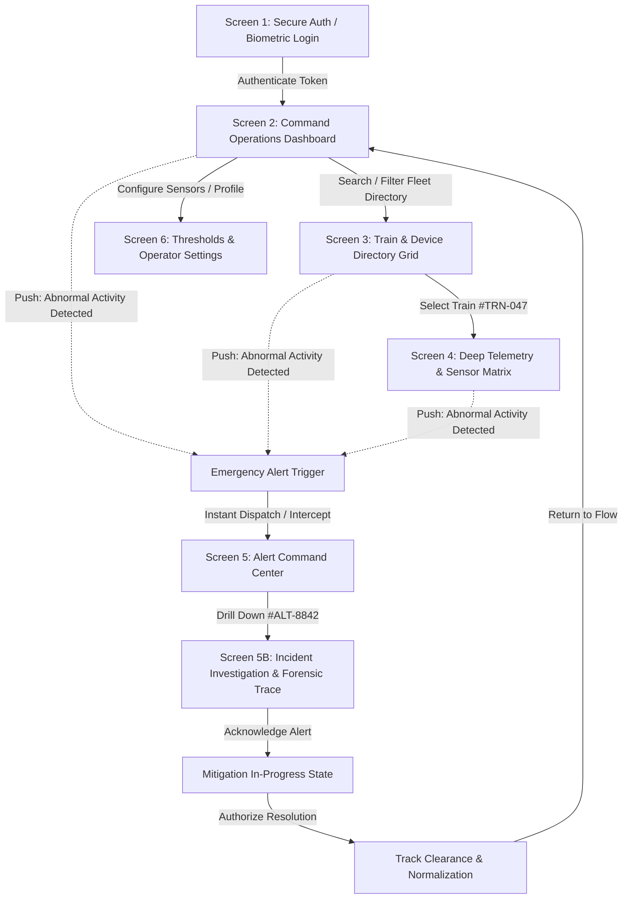

# RailSense Pro — UI/UX Design System, Figma Specifications & UX Flow Architecture

---

## 1. Executive Summary & Brand Personality

**RailSense Pro** is a mission-critical, enterprise-grade autonomous train and IoT edge telemetry surveillance platform. Engineered for rail operators, fleet dispatchers, and safety engineers, the interface bridges complex real-time edge telemetry with effortless cognitive decision-making during high-stress anomaly events.

### Brand Archetype & Design Theme
* **Aesthetic**: *Cyber-Glassmorphism & High-Contrast Operations Console*
* **Tone**: Authoritative, Ultra-Precise, Fluid, Calibrated
* **Visual Hierarchy Principle**: Instant anomaly triage within `< 500ms` glance time.
* **Palette Foundation**: Deep cosmic navy (`#050814`) with luminescent status tokens (Electric Cyan `#00F2FE`, Neon Emerald `#10B981`, Amber Warning `#F59E0B`, Hyper Red `#FF3366`, Royal Indigo `#8B5CF6`).

---

## 2. End-to-End UX User Flow

The platform is architected around a 6-stage operational cycle:

---

## 3. UI Screen Architecture (Wireframe → Final UI Specification)

### Screen 1: Secure Operator Login Portal
* **Purpose**: Identity verification, hardware key authentication, and baseline network status inspection.
* **Key Components**:
  * Dual-column layout: Left branding & live fleet telemetry preview; Right glassmorphic credential card.
  * Interactive Biometric / FIDO2 status indicators.
  * Kinetic ambient canvas with background particle mesh.
* **Micro-interactions**: Button ripple sweep, input focus cyan glow box-shadow, GSAP scale-in transition.

### Screen 2: Central Command Dashboard
* **Purpose**: Macro-level situational awareness across all 142 active express lines and 6 regional sectors.
* **Key Components**:
  * **Dynamic Alert Banner**: High-priority flashing notification when an unacknowledged anomaly is pending.
  * **4 KPI Telemetry Cards**: Total Fleet, On-Time Performance (99.4%), Sensor Ingestion Rate (24.1k/s), Open Incidents (3).
  * **Real-time Velocity & Vibration Stream Canvas**: 60-minute historical trend with threshold line co-plotting.
  * **Active Route Health Bars**: Route A-05 (Normal), Route B-12 (Critical 54%), Route C-08 (Warning), Route D-14.
  * **Quick Monitored Device Table**: Top 5 active trains with instant telemetry links.

### Screen 3: Train Fleet & Edge Device Directory
* **Purpose**: Micro-management and surveillance of all onboard hardware nodes.
* **Key Components**:
  * **Filter Pill Bar**: `ALL (142)`, `CRITICAL (1)`, `WARNING (2)`, `NORMAL (135)`, `MAINT (4)`.
  * **Global Fast Search**: Dynamic lookup across Train ID, Corridor Route, Driver, or Hardware serial number.
  * **Multi-column Sorting**: By severity rank, velocity, or Train ID.
  * **High-density Data Table**: Train ID, Route, Real-time location, Velocity, Hydraulic Brake Pressure, Motor Temperature, Status Badge with pulsing live dot, and Inspect trigger.

### Screen 4: Device Telemetry & Sensor Deep-Dive (`TRN-047`)
* **Purpose**: Granular diagnosis of individual train hardware during active runs.
* **Key Components**:
  * **Bogie-2 Hydraulic Pressure Indicator**: Displaying anomaly state (`2.1 Bar` vs `6.5 Bar` nominal).
  * **Current Velocity Failsafe Gauge**: Dynamic display of speed retardation to `38 km/h`.
  * **Sensor Waveform Canvas**: Continuous dual trace graphing pressure drop against speed deceleration.
  * **Sensor Grid Matrix**: Transducer PT-04 (Anomaly), Axle Accelerometer VA-02 (Normal), Wheel Slip WSS-01 (Normal), Climate/Smoke sensors.

### Screen 5 & 5B: Alert Command & Incident Resolution
* **Purpose**: Incident containment, communication with trackside teams, and legal sign-off.
* **Key Components**:
  * **Chronological Timeline**: Millisecond incident progression (`00:42:18` failure detected → `00:42:21` failsafe deceleration → `00:42:35` broadcast → `00:43:10` track interlocking locked).
  * **Forensic Spectrogram Canvas**: Axle box FFT vibration trace displaying mechanical chatter.
  * **Two-Step Resolution Flow**:
    1. `Acknowledge Alert`: Locks operator ownership, silences audible siren, moves card to active handling.
    2. `Authorize Resolution`: Records corrective action notes, clears corridor interlocks, and logs ISO-26262 ASIL-D compliance audit entry.

### Screen 6: Operator Profile & Sensor Threshold Tuning
* **Purpose**: Sensor sensitivity calibration, alert routing, and operator credentials.
* **Key Components**:
  * **Operator ID Card**: Staff badge, terminal routing, clearance level (`ASIL-D / L5`).
  * **Live Range Sliders**:
    * Min Brake Pressure Emergency Threshold (Adjustable `3.0` – `7.0 Bar`).
    * Max Traction Motor Temp (`65°C` – `110°C`).
    * Bogey Vibration Acceleration tolerance (`0.10` – `1.00 g`).
    * Corridor Max Speed Ceiling (`100` – `250 km/h`).
  * **Toggle Controls**: Synthesized Audio Cues, Ambient Canvas rendering, Telemetry interpolation.

---

## 4. Figma Component Taxonomy & Design Tokens

### Color Tokens
| Token Name | Hex Code | Purpose |
|---|---|---|
| `surface-bg-dark` | `#050814` | Global viewport background |
| `surface-glass-panel` | `rgba(13, 20, 42, 0.72)` | Card and panel container |
| `border-glass-default` | `rgba(0, 242, 254, 0.12)` | Subtle glassmorphic border |
| `accent-cyan-400` | `#00F2FE` | Primary action, active tab, high-tech glow |
| `accent-indigo-500` | `#4FACFE` | Secondary gradient accent |
| `status-normal-emerald` | `#10B981` | Optimal operation, normal health |
| `status-warning-amber` | `#F59E0B` | Thermal spikes, non-critical telemetry latency |
| `status-critical-rose` | `#FF3366` | Hydraulic failure, collision mitigation, emergency stop |

### Typography Scale
* **Primary Sans**: `Plus Jakarta Sans`
  * Display Heading: `32px` / `36px` Extrabold (`letter-spacing: -0.02em`)
  * Section Title: `20px` Bold
  * Card Label: `14px` Semibold
  * Body Text: `12px` / `13px` Regular (`line-height: 1.6`)
* **Telemetry Mono**: `JetBrains Mono`
  * Metric Value: `28px` / `32px` Black
  * Sensor IDs, Timestamps, Bar Readings: `11px` / `12px` Medium

### Status Indicator Variants (Figma Component: `Status_Badge`)
1. **Normal**:
   * Background: `rgba(16, 185, 129, 0.2)`
   * Text & Border: `#10B981` / `rgba(16, 185, 129, 0.4)`
   * Icon: Steady green dot (`●`)
2. **Warning**:
   * Background: `rgba(245, 158, 11, 0.2)`
   * Text & Border: `#F59E0B` / `rgba(245, 158, 11, 0.4)`
   * Icon: Amber hazard indicator (`🟠`)
3. **Critical**:
   * Background: `rgba(255, 51, 102, 0.25)`
   * Text & Border: `#FF3366` / `rgba(255, 51, 102, 0.6)`
   * Animation: Outer ring ping + 1.8s pulsing glow box-shadow

---

## 5. GSAP Animation Choreography

| Interaction Event | Target Element | GSAP Parameters / Tweens |
|---|---|---|
| Screen Switch | `.screen-view` | `gsap.fromTo(view, {opacity: 0, y: 15, scale: 0.99}, {opacity: 1, y: 0, scale: 1, duration: 0.35, ease: 'power2.out'})` |
| Metric Counter Rollup | `.counter-num` | Staggered numeric interpolation over `1.2s` (`step = target / 40`) |
| Emergency Alert Trigger | `#emergency-toast` | `gsap.to(toast, {x: 0, duration: 0.45, ease: 'back.out(1.4)'})` |
| Telemetry Stream | `<canvas>` | 60 FPS RequestAnimationFrame curve draw with gradient fill area |
| Alert Resolution | `#alert-card-1` | `gsap.to(card, {scale: 0.98, opacity: 0.35, duration: 0.5, ease: 'power3.inOut'})` |

---

## 6. Edge Case & State Matrix

* **Loading State**: Shimmering gradient skeleton blocks (`rgba(255, 255, 255, 0.04)` to `0.08`).
* **Empty Search State**: Monospaced clear feedback prompt: `🔍 No train or edge sensor found matching "query"`.
* **Telemetry Disconnection**: Fallback satellite backup icon, displaying last known coordinates with timestamp decay indicator.
* **Audio Feedback**: Dual mode Web Audio API synthesizers (Click: `800Hz → 1200Hz`; Alert Siren: `440Hz ↔ 880Hz` dual sawtooth oscillation; Resolution: `523Hz – 1046Hz` major chord chime).
